# Kolhapuri Kala – Artisan Chappal Showcase

## 1. Project Introduction and Objective
Kolhapuri Kala is a small catalog website that showcases the artisans of Kolhapur and their handcrafted Kolhapuri chappals. Visitors can meet the craftsmen, browse chappals by type, and send an order enquiry.

**Objective:** Build a website, manage it with Git and GitHub using meaningful commits, and integrate a DevOps tool (GitHub Actions CI) that checks the website automatically on every push.

## 2. Technology Stack
| Area | Tool |
|------|------|
| Frontend | HTML, CSS, JavaScript |
| Version control | Git, GitHub |
| DevOps tool | GitHub Actions (CI) |
| Editor | VS Code |

## 3. How to Run
```bash
git clone https://github.com/Rahul-7620/kolhapuri-kala.git
cd kolhapuri-kala
```
Open `index.html` in any browser. No installation is needed.

## 4. Folder Structure
```
kolhapuri-kala/
├── .github/workflows/ci.yml
├── css/style.css
├── js/script.js
├── images/            (proof screenshots)
├── index.html
└── README.md
```

## 5. Project Screenshots

### Base website
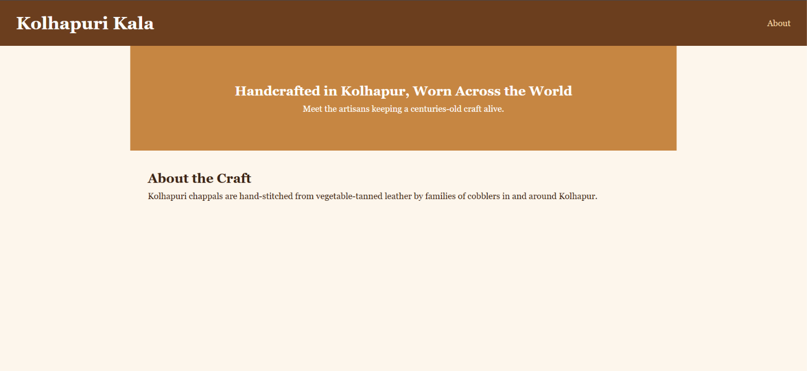
*Figure 1: Base homepage.*

## 6. Changes Made (with commits)

| # | Change | Commit message |
|---|--------|----------------|
| 0 | Base structure and homepage | `Initial commit: base structure and homepage` |
| 1 | Artisan profiles section | `feat: add artisan profiles section` |
| 2 | Product catalog with type filter | `feat: add product catalog with type filter` |
| 3 | Dark mode toggle | `feat: add dark mode toggle` |
| 4 | Order enquiry form with validation | `feat: add order enquiry form with validation` |
| 5 | Footer and mobile responsive layout | `style: add footer and mobile responsive layout` |

### Change 1: Artisan profiles
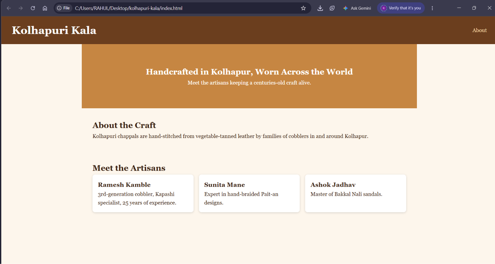
*Figure 2: Three artisan cards added.*

### Change 2: Product catalog with filter
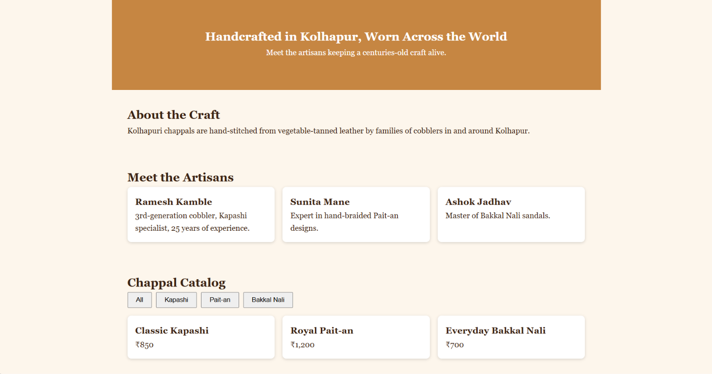
*Figure 3: Catalog filtered by Kapashi.*

### Change 3: Dark mode toggle
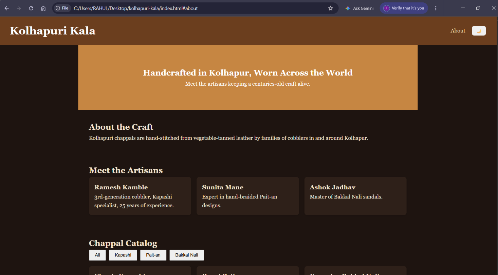
*Figure 4: Website in dark mode.*

### Change 4: Order enquiry form
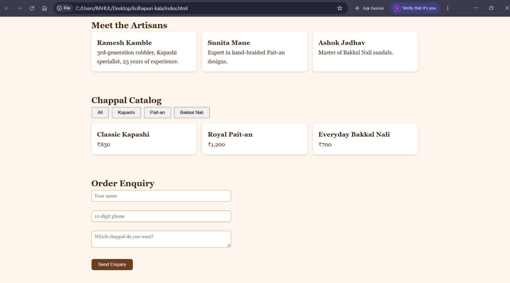
*Figure 5: Form showing phone validation error.*

### Change 5: Footer and mobile layout
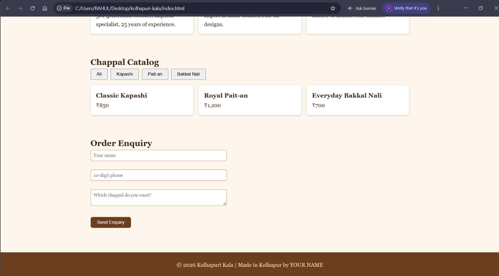
*Figure 6: Mobile view with footer.*

## 7. Git and GitHub Workflow
```bash
git init
git add .
git commit -m "Initial commit: base structure and homepage"
git branch -M main
git remote add origin https://github.com/Rahul-7620/kolhapuri-kala.git
git push -u origin main
```
For each change:
```bash
git add .
git commit -m "<message>"
git push
git log --oneline
```
A `.gitignore` file was added to exclude the editor folder `.vs/`.

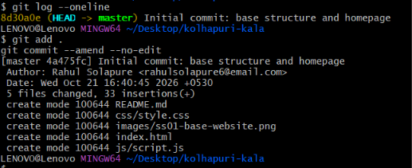
*Figure 7: First commit in terminal.*

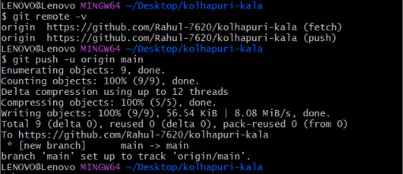
*Figure 8: Repository on GitHub.*

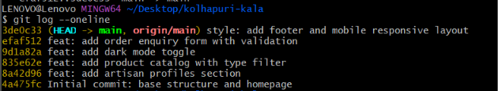
*Figure 9: Output of `git log --oneline`.*

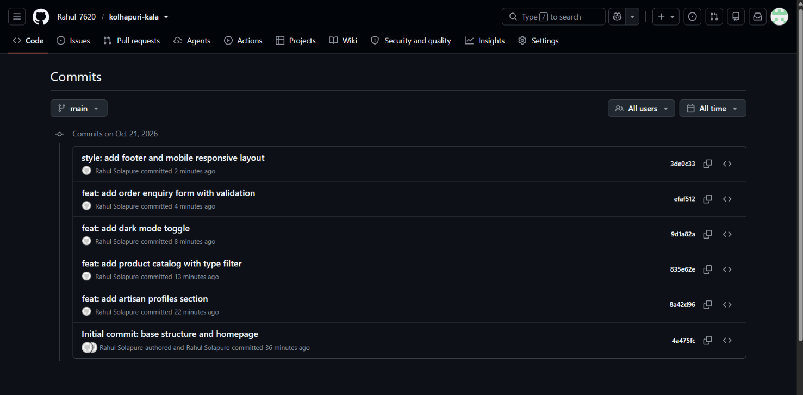
*Figure 10: Commit history on GitHub.*

## 8. DevOps Tool Integration: GitHub Actions

**Why GitHub Actions:** It runs on GitHub's servers and needs no local installation. It automatically checks the website on every push.

**Steps:**
1. Created the folder `.github/workflows/`.
2. Added the workflow file `ci.yml`.
3. Committed and pushed it to the `main` branch.
4. Opened the **Actions** tab on GitHub to view the run.

**What the pipeline does on every push:**
- Checks out the code
- Confirms `index.html`, `css/style.css` and `js/script.js` exist
- Validates the HTML with `tidy`
- Checks the JavaScript syntax with `node --check`
- Prints a success summary

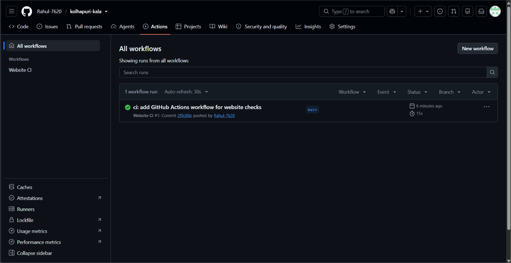
*Figure 11: Workflow run passed (green tick).*

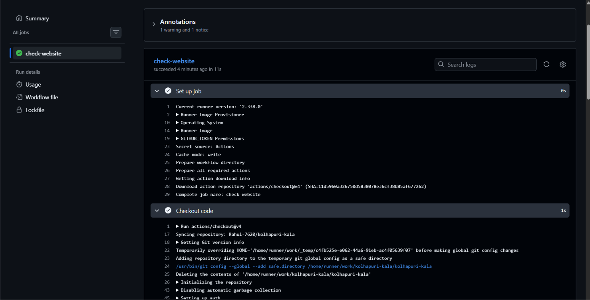
*Figure 12: All pipeline steps passed.*

## 9. Conclusion
The project meets the requirements: a working website, more than 5 meaningful commits, and a DevOps tool (GitHub Actions) integrated with proof screenshots.

**Author:** Rahul
**Repository:** https://github.com/Rahul-7620/kolhapuri-kala